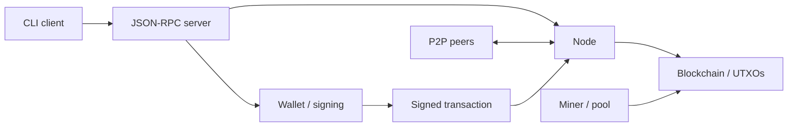

# SALOCOIN

### Open-source Bitcoin-like cryptocurrency and blockchain code in Python

**Explore the source. Understand the components. Customize your own coin and network.**

[Getting started](docs/GETTING_STARTED.md) · [Documentation](docs/README.md) · [Build your own coin](docs/CREATE_YOUR_OWN_COIN.md) · [Contributing](CONTRIBUTING.md) · [Security](SECURITY.md)

[](LICENSE)
[](docs/GETTING_STARTED.md)

SALOCOIN is an MIT-licensed Python cryptocurrency implementation with Bitcoin-inspired UTXO transactions, SHA-256d Proof-of-Work, wallet key derivation, P2P networking and JSON-RPC. Use it to study blockchain internals or as a starting point for an experimental cryptocurrency fork.

> **Project status:** experimental. Wallet files contain plaintext keys; use disposable keys for learning. Independent networks require consensus and discovery changes. Read the [security limitations](SECURITY.md) before handling real value.

## What you can explore

| Component | What is in the repository | Start reading |
| --- | --- | --- |
| Blockchain | Blocks, transaction validation, UTXO lookup and chain storage | [Blockchain source](core/blockchain.py) |
| Wallet | Address generation, signatures, mnemonic/HD derivation and JSON persistence | [Wallet source](core/wallet.py) |
| Networking | Binary P2P messages, peers and seed discovery | [Network source](network/node.py) |
| APIs | JSON-RPC for node/wallet control and separate HTTP node APIs | [API guide](docs/API.md) |
| Mining | CPU/GPU miners, pool code and solo proxy | [Component guide](docs/COMPONENTS.md) |
| Customization | Parameters for identity, rewards, difficulty, addresses and discovery | [Customization guide](docs/CUSTOMIZATION.md) |

The project implements its own protocol and consensus rules. It does not provide Ethereum/EVM compatibility, and sharing SHA-256d does not establish Bitcoin wire, wallet or ASIC interoperability.

## Try it locally

You need Git and Python 3.10 or newer. The basic setup does not require a GPU, desktop toolkit or public node.

**Linux / macOS**

```sh
git clone https://github.com/saloscoin/open-source.git
cd open-source
python3 -m venv .venv
.venv/bin/python -m pip install -r requirements-core.txt
.venv/bin/python examples/offline_walkthrough.py
.venv/bin/python -m pytest -q
```

**Windows PowerShell**

```powershell
git clone https://github.com/saloscoin/open-source.git
cd open-source
py -3 -m venv .venv
.\.venv\Scripts\python.exe -m pip install -r requirements-core.txt
.\.venv\Scripts\python.exe examples\offline_walkthrough.py
.\.venv\Scripts\python.exe -m pytest -q
```

The walkthrough creates a disposable keypair, verifies a signature, rejects a changed message, reloads a temporary wallet, and constructs an 80-byte block header. It opens no network connection, mines no block, prints no secrets, and removes temporary wallet data when it finishes.

Expected output:

```json
{
  "signature_verified": true,
  "changed_message_rejected": true,
  "wallet_reload_verified": true,
  "block_template_height": 1,
  "block_header_bytes": 80,
  "template_mined_or_broadcast": false
}
```

Continue with [getting started](docs/GETTING_STARTED.md) for persistent wallets and node operation, or [troubleshooting](docs/TROUBLESHOOTING.md) if setup fails.

## How the components fit



RPC and REST are separate interfaces with different access controls. Read the [architecture](docs/ARCHITECTURE.md) and [API guide](docs/API.md) before exposing a service.

## Create your own cryptocurrency

A new coin needs more than a name change. Define its issuance and consensus rules, construct a consistent genesis block, choose distinct network identifiers, replace upstream seeds/services, and test controlled peers with fresh data.

The [new coin and independent network guide](docs/CREATE_YOUR_OWN_COIN.md) walks through those decisions. The [parameter reference](docs/CUSTOMIZATION.md) points to the source locations to inspect. There is no verified one-command independent-network preset yet.

Default source parameters include a 150-second target block time, 100-coin initial reward, and 210,000-block halving interval. Review the minimum reward floor and supply-cap enforcement before advertising a fixed supply.

## Contribute

Bug reports, documentation improvements, reproducible examples and focused code patches are welcome. Start with [CONTRIBUTING.md](CONTRIBUTING.md); issue forms and a PR template help capture the information reviewers need. Pseudonymous contributions are welcome. Never include wallet files, recovery phrases, credentials or personal information in public reports.

See [unreleased changes](CHANGELOG.md), [security reporting](SECURITY.md), and the [MIT License](LICENSE). No production audit or current public-service availability is claimed.
